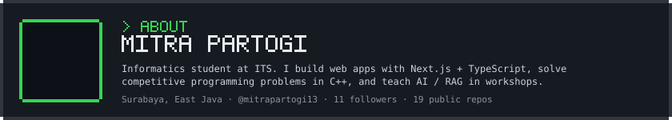
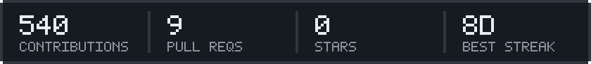
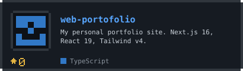
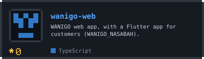
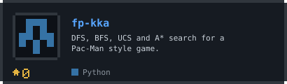
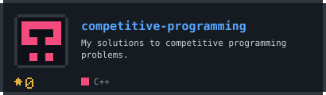

  

  The window shows the weather in Surabaya at the last update. The monitor scrolls my latest commits, and the shelf has one book for each language I use.

  <a href="https://mpartogi.vercel.app">Portfolio</a> ·
  <a href="https://www.instagram.com/mitrapartogiii._/">Instagram</a>

  
  

  
  

  

Pixel art drawn by <a href="scripts/build.py">scripts/build.py</a> · refreshed every 6 hours by GitHub Actions

